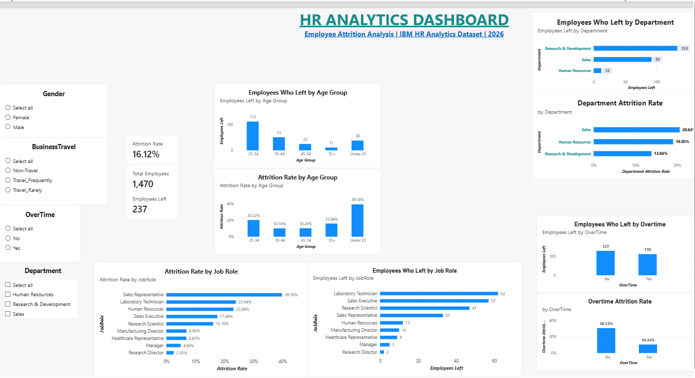

# HR Analytics & Employee Attrition Analysis

## Project Overview

This project analyzes employee data to understand workforce attrition patterns and identify factors associated with employee turnover.

The analysis uses the IBM HR Analytics Employee Attrition dataset, containing **1,470 employee records and 35 columns**.

## Project Objectives

- Calculate the overall employee attrition rate.
- Identify departments with higher employee turnover.
- Analyze the relationship between overtime and attrition.
- Examine attrition across different age groups.
- Identify job roles with higher attrition rates.
- Build an interactive Power BI dashboard to present key findings.

## Tools & Technologies

- **Microsoft Excel:** Data validation, cleaning and exploratory analysis.
- **SQL (SQLite):** Data querying and analytical calculations.
- **Power BI:** Interactive dashboard and data visualization.
- **GitHub:** Project documentation and version control.

## Key Performance Indicators

| Metric | Result |
|---|---:|
| Total Employees | 1,470 |
| Employees Who Left | 237 |
| Overall Attrition Rate | 16.12% |

## Key Findings

1. **Department:** Sales had the highest attrition rate at 20.63%.
2. **Overtime:** Employees working overtime had a 30.53% attrition rate, compared with 10.44% for employees not working overtime.
3. **Job Role:** Sales Representatives had the highest job-role attrition rate at 39.76%.
4. **Age Group:** Employees under 25 had the highest attrition rate among the analyzed age groups, at 39.18%.

## Power BI Dashboard

The interactive dashboard includes:

- Overall employee KPIs.
- Department-wise attrition analysis.
- Overtime-based attrition analysis.
- Age-group analysis.
- Job-role attrition analysis.
- Filters for Department, Gender, Overtime and Business Travel.

### Dashboard Preview



### Dashboard Files

- [Power BI Dashboard (.pbix)](PowerBI/HR_Analytics_Dashboard.pbix)
- [Dashboard PDF Report](PowerBI/HR_Analytics_Dashboard.pdf)
- [Dashboard Screenshot](Screenshots/HR_Analytics_Dashboard.png)

## Repository Structure

```text
HR-Analytics-Employee-Attrition/
├── PowerBI/
│   ├── HR_Analytics_Dashboard.pbix
│   └── HR_Analytics_Dashboard.pdf
├── Screenshots/
│   └── HR_Analytics_Dashboard.png
├── reports/
├── sql/
└── README.md
```

## Conclusion

This project demonstrates the use of Excel, SQL and Power BI to analyze employee attrition and identify workforce trends. The findings highlight differences in attrition across departments, job roles, age groups and overtime categories, providing useful insights for employee retention analysis.

**Project Status:** Completed

**Author:** Sweta

**GitHub Repository:** https://github.com/nppsweta/HR-Analytics-Employee-Attrition
